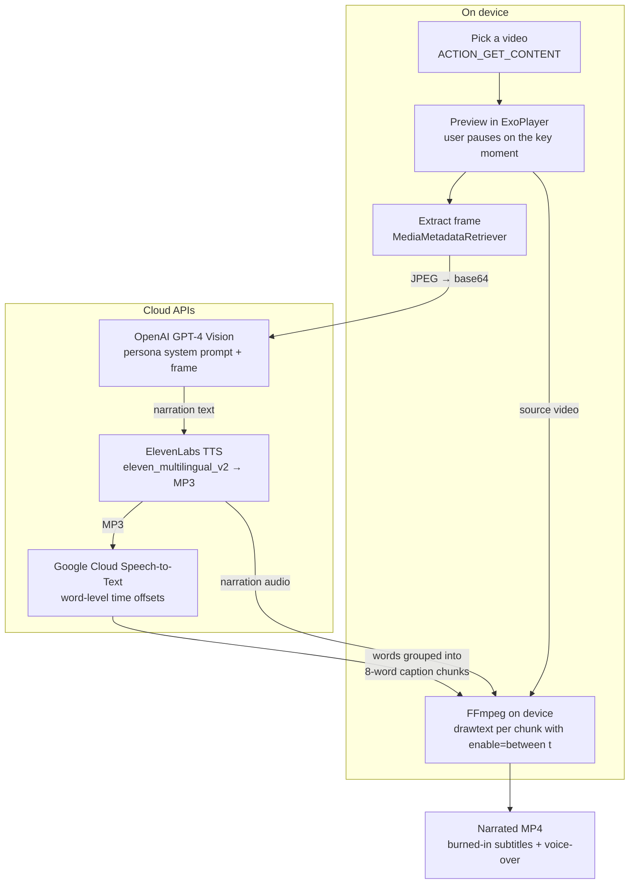

# AI Video Narrator

An Android app that turns a raw video clip into a **narrated video with synced, burned-in subtitles**. You pick a video and choose a key moment, and the app takes it from there. A vision LLM writes a short in-character narration of that moment (for example, a snarky nature-documentary voice). The narration is voiced with neural TTS, word-level timestamps are extracted, and FFmpeg renders the final MP4 on the device with timed captions and the new voice-over track.

I built it in late 2023 – early 2024, shortly after GPT-4 Vision came out, as a hands-on experiment with early LLM, vision and TTS APIs on mobile. The code is kept **as it was written then**. The [What I'd do differently today](#what-id-do-differently-today) section lists the known problems.

## Demo

> 🎬 _Demo GIF / video coming soon._
>
> `` · [Watch on YouTube](https://example.com)

## How it works



1. **Frame selection.** The user scrubs the video in ExoPlayer. The paused position is used to grab **one frame** with `MediaMetadataRetriever` (nearest keyframe).
2. **Narration.** The frame is sent to `gpt-4-vision-preview` together with a selectable *script*: a persona system prompt, a user command, an ElevenLabs voice and a language. Two presets are built in: an English nature-documentary narrator and a Russian K-drama narrator.
3. **Voice-over.** ElevenLabs `eleven_multilingual_v2` turns the narration into an MP3.
4. **Timing.** The generated MP3 goes through Google Cloud Speech-to-Text v1 with `enableWordTimeOffsets` to get word timestamps. Words are grouped into 8-word caption chunks.
5. **Render.** FFmpeg (`mobile-ffmpeg`) chains one `drawtext` filter per chunk, each enabled only between its start and end times. It re-encodes the video with `libx264` and replaces the audio track with the narration. Subtitles are **burned in**; there is no separate subtitle track.

Every step writes its status to a live log in a bottom sheet, so you can watch the pipeline run.

## Tech stack

| Area | Used |
|---|---|
| Language / UI | Kotlin, Android Views, DataBinding, Material Components, Navigation Component |
| Architecture | MVVM + Repository, LiveData, Kotlin Coroutines (`liveData {}` builder) |
| DI | Dagger 2 + dagger-android |
| Networking | Retrofit 2, OkHttp 4, Gson; `openai-client` (Kotlin, Ktor) |
| AI services | OpenAI GPT-4 Vision · ElevenLabs Text-to-Speech · Google Cloud Speech-to-Text (gRPC) |
| Media | ExoPlayer 2 (preview), `MediaMetadataRetriever` (frame grab), mobile-ffmpeg (render) |
| Build | Gradle 7.5, AGP 7.4.2, Kotlin 1.8, minSdk 24 / targetSdk 33 |

## Setup

### 1. API keys

Keys are not stored in the repository. They are read from `local.properties` at build time and exposed through `BuildConfig`.

```bash
cp local.properties.example local.properties
```

Then fill in:

| Key | What it's for |
|---|---|
| `OPENAI_API_KEY` | GPT-4 Vision: describe the frame and write the narration |
| `ELEVENLABS_API_KEY` | Text-to-speech |
| `GOOGLE_CLOUD_CREDENTIALS_FILE` | Path to a Google Cloud service-account JSON with Speech-to-Text enabled (e.g. `secrets/google_cloud_credentials.json`; `secrets/` is gitignored) |

> ⚠️ This is a prototype: the keys end up inside the APK, so only use restricted, low-quota keys for local testing.

### 2. Build

- Use **JDK 17**. Gradle 7.5 does not run on JDK 21. If your global Gradle config points at Android Studio's bundled JBR, override it:
  ```bash
  ./gradlew assembleDevDebug -Dorg.gradle.java.home="/path/to/jdk-17"
  ```
- **Known issue:** the render step depends on `com.arthenica:mobile-ffmpeg-full-gpl:4.4`. mobile-ffmpeg and its successor ffmpeg-kit have been retired, and their binaries are no longer published. To build, add an FFmpeg-kit-compatible AAR locally (e.g. under `app/libs/`) or swap in a maintained fork. Only `TextOnVideo.kt` uses it.

### 3. Run

1. Launch the app and grant storage access.
2. Pick a video and pause on the moment you want narrated.
3. Choose a script (voice + persona).
4. Tap **Analyze video** and watch the log: frame → GPT-4V → ElevenLabs → Speech-to-Text.
5. Tap **Create video**. The result is saved to `/sdcard/NarratorMediaFiles/video/`.

## Project structure

```
app/src/main/java/kz/narrator/app/
├── ui/main_page/            # Main screen, MainPageViewModel orchestrates the pipeline
├── ui/ai_processor/
│   ├── video_crop/          # Frame extraction
│   ├── image_analyze/       # GPT-4 Vision request
│   ├── text_to_speech/      # ElevenLabs request
│   └── speech_to_text/      # Google STT → caption timestamps
├── ui_common/video_tools/   # FFmpeg renderer (TextOnVideo), default scripts
├── data/repository/ai_repos # OpenAI + ElevenLabs repository
├── network/api/AiApi.kt     # ElevenLabs Retrofit API
└── di/                      # Dagger modules
```

## What I'd do differently today

The project works as a prototype, but looking back at it, these are the real problems in the code and how I'd fix them:

- **Get the keys off the device.** Every key ships in the APK, including a Google Cloud service-account private key. I'd put the AI calls behind a small backend or proxy with per-user auth, rate limits and short-lived tokens (plus Play Integrity / App Check).
- **Drop the TTS → STT round trip.** Timestamps currently come from transcribing my own TTS audio. That adds an extra paid API call and latency, and the captions show the *recognized* text instead of the generated script. ElevenLabs' `with-timestamps` endpoint (or forced alignment) returns exact timings for the real text.
- **Fix caption timing.** Only the first STT result is used, so long narrations lose their final captions. Timestamps are also truncated to whole seconds, so captions can drift by up to a second. I'd keep millisecond precision and generate a proper subtitle track (SRT/WebVTT) alongside the burned-in version.
- **Look at more than one frame.** The model only sees a single keyframe. I'd sample several frames across the clip (or use a model that accepts video) and downscale them before upload. Today the full-resolution frame is sent as base64, which wastes tokens.
- **Move heavy work out of the UI layer.** The pipeline is chained through LiveData events and callbacks between ViewModels, and the FFmpeg render runs in a Fragment's `lifecycleScope`. If you leave the screen, the work is lost. I'd model it as use cases in a domain layer (Clean Architecture), run it as a `WorkManager` job with progress notifications, and persist intermediate results so a failed step can resume.
- **Coroutines and Flow all the way down.** Replace `GlobalScope`, blocking calls and main-thread work (frame extraction, base64 encoding) with structured concurrency, `Dispatchers.IO`/`Default` and a `StateFlow`-based UI state.
- **Real error handling.** Add retries with exponential backoff and timeouts for each API, typed errors instead of string matching (refusals are detected by checking the response text), and no `!!`/`lateinit` crash paths. An empty STT result currently crashes the app.
- **Cost control.** Cache results per frame/script, cap tokens and conversation history (it currently grows without limit), and show the estimated cost before a run.
- **Modern media stack.** Replace the retired mobile-ffmpeg with Media3 Transformer (text overlays + audio mixing on the hardware encoder) or render on the server. Keep the original audio ducked under the narration instead of discarding it, and save the result through MediaStore instead of `MANAGE_EXTERNAL_STORAGE`.
- **Tests.** Unit tests for timestamp chunking and FFmpeg filter building (including escaping special characters in `drawtext`), plus contract tests with mocked API responses.

## Credits

The FFmpeg `drawtext` helper (`TextOnVideo`) is adapted from an open-source sample by Umair Adil.
